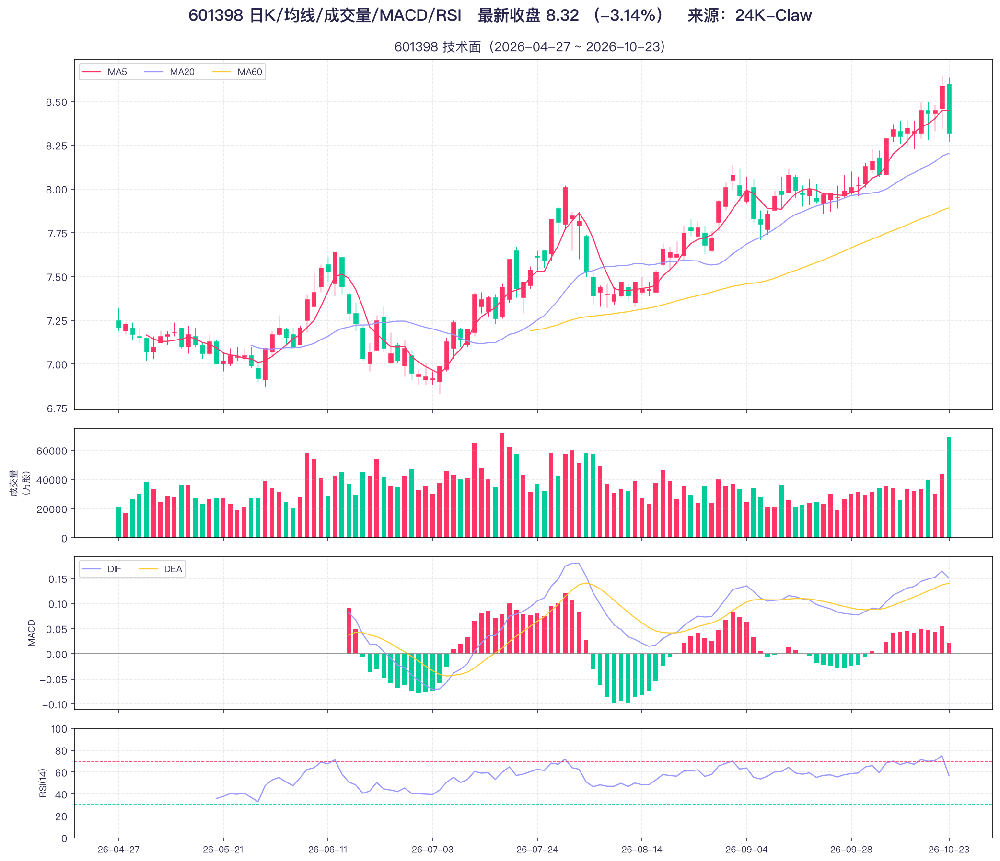

# Oh My Mini Quant (OMMQ)

基于 OpenCode 平台+ 通达信软件+ Akshare。让小白用户也能通过AI助手从行情数据、财报分析到个股深度研究、估值与龙虎榜博弈的全流程投研任务，输出结构化研报。

> 本项目输出仅供研究与学习参考，不构成任何投资建议。

## 项目简介

OMMQ 是一个**轻量级、本地优先**的 A股、期货投研工作台，不依赖MCP服务，不依赖靠积分充值的范办公工具。内置各类绘图脚本、量化策略。由 Agent 与 SubAgent 按任务类型调度，最终产出结构化、可落盘的研报、量化选股池子、量化回测结果等。

## 部分案例

以下图表均由项目脚本自动生成（数据日期 2026-10-19，来源：24K-Claw）：

**A 股市场全景日报**（`market_overview.py`）


**市场情绪**（`market_sentiment.py`）


**板块涨跌幅 TOP5**（`sector_top5_chart.py`）


**申万一级行业轮动热力图**（`sector_rotation_heatmap.py`）


**资金流趋势（两融）**（`money_flow_trend.py`）


**商品期货主力合约涨跌幅 TOP5**（`futures_top5_chart.py`）


**期货量仓**（`futures_volume_oi.py`）


**技术分析**（`stock_technical.py`）



## 核心能力：

- **取数**：通过通达信接口获取行情、K 线、财务、龙虎榜等原始数据
- **分析**：财报速读、个股深度研究、公司质地打分、估值研判、龙虎榜掘金、业绩预告博弈
- **交互**：推荐 `OpenCode`  开源工具及内置的免费模型，实现 0 费用对话与分析；
- **补充数据源**：第三方数据补充（`strategies/` 下的脚本全部基于 Akshare 取数）
- **量化策略**：`strategies/` 提供市场全景、情绪、资金流、板块轮动、期货、个股财务与技术面等可独立运行的图表脚本
- **量化计算与绘图**：pandas / numpy / scipy / TA-Lib 计算，matplotlib / seaborn 出图
- **产出归档**：正式报告与图表统一落盘至 `reports/`


## 策略脚本

`strategies/` 下的脚本**独立于技能体系**，直接用拉取公开数据并出图，可单独运行或作为取数参考。图表产物按**当天日期**统一写入 `reports/YYYYMMDD/`（编号规则见 `strategies/plot_paths.py`：核心八图 01–08、扩展研究图 09 起，参数化脚本以代码作后缀避免覆盖）；股票财务脚本导出的 CSV 数据文件仍存 `strategies/output/financials/`。

| 脚本                                 | 用途                                       |
| ---------------------------------- | ---------------------------------------- |
| market_overview.py              | A 股市场全景日报：四大指数走势（归一化）+ 成交额 + 涨跌家数   |
| global_index_week_curve.py       | 全球三大指数周度累计收益曲线：沪深300 / 恒生指数 / 标普500  |
| market_sentiment.py              | 市场情绪：涨停/跌停家数趋势、连板梯队、涨停行业分布          |
| money_flow_trend.py              | 杠杆资金（两融）趋势：融资余额、两融余额、单日净增           |
| sector_top5_chart.py            | 申万一级行业 / 概念板块 涨跌幅 TOP5                       |
| sector_rotation_heatmap.py      | 申万一级行业板块轮动热力图（行=行业，列=交易日）             |
| industry_valuation_percentile.py | 申万一级行业 PE / PB 当前值及近 5 年历史分位              |
| futures_basis_spread.py          | 期货基差与跨期价差：期货 vs 现货、近月 vs 远月、股指基差   |
| futures_top5_chart.py           | 国内商品期货主力合约 涨幅/跌幅 TOP5                      |
| futures_volume_oi.py           | 期货量仓：主力合约成交量与持仓量、日增仓                     |
| stock_financials.py            | 个股财务：主要指标 + 三大报表（季度口径），导出 CSV 并出图   |
| stock_financials_annual.py      | 年度财务概览：营收 / 净利 / EPS / ROE 长周期趋势         |
| stock_money_flow.py             | 个股资金流                                    |
| stock_technical.py               | 个股技术面：日 K + MA5/20/60 + 成交量 + MACD + RSI |
| peer_dupond.py                   | 同业杜邦分析 / 财务估值横向对比                        |
| charts_demo.py                | 绘图示例：折线、柱状、直方、热力图各一张                     |
| neff_value_strategy.py        | 约翰·内夫(John Neff)低PE价值投资策略/选股/回测/监控/模板 4 个功能全部内置在里面|

## 技能清单

| 技能 ID          | 名称            | 说明                                                                |
| -------------- | ------------- | ----------------------------------------------------------------- |
| tdx-tq-local | 通达信 TQ-Local  | 通过本机 HTTP 服务（JSON-RPC，`127.0.0.1:17709`）直接调用 `tqcenter` 接口，**首选** |
| tdx-aidata    | 通达信AiData | 跨平台（Windows / macOS / Linux）|
| tdx-quant   | 通达信 TQ-Python | 生成 Python 代码，通过 `tqcenter.py` 模块与本地通达信客户端交互                       |
| tdx-financial-quick-read | 财报速读   | 三表关键指标提取、多期趋势对比、财务异常检测、盈利能力诊断与同业对标 |
| tdx-stock-analysis      | 个股深度分析 | 单只 A 股全面研究，输出结构化一页纸报告（九大维度）        |
| tdx-gszddf           | 公司质地打分 | 长期质地结构化评估打分，区分"好公司"与"好股票"，辅助长线选股   |
| tdx-valuation-navigator  | 估值导航员  | 估值方法选择、估值合理性、市场交易预期、重估/杀估值风险       |
| tdx-dragon-tiger-miner  | 龙虎榜掘金  | 龙虎榜明细拆解、机构/北向/游资席位意图、买卖力量评分、三日榜分析  |
| tdx-yjygby              | 业绩预告博弈 | 业绩发布前后的市场交易、预期差、博弈路径与多情景推演         |

## Agent

每个 Agent 可以配置独立的系统提示词、模型、工具访问权限和行为约束，用于处理特定类型的任务和工作流程。你可以在会话期间随时切换代理，或通过 `@` Agent名称 的方式直接调用特定代理。

### 本项目 Agent 
全局：`~/.config/opencode/agents/`（对所有项目有效）

项目：`.opencode/agents/`（仅对当前项目有效）

### Agent目录

| Agent                | 用途                         |
| ---------------------| ----------------------------|
| Build （主Agent）| 默认，启用了所有工具，适合需要完整文件操作和系统命令访问权限的日常开发工作。这是你最常使用的代理。|
| Plan （主Agent）| 专为代码分析和规划设计的受限代理。|
| TdxQuant（子Agent） | 通过通达信获取数，输出结构化研报。|
| General （子Agent）| 通用子代理，拥有完整的工具访问权限，可以修改文件。适用于研究复杂问题和执行多步骤任务，也可以并行运行多个独立的工作单元。|
| Explore （主Agent）| 只读子代理，无法修改任何文件。适合快速查找文件、搜索代码关键字或回答关于代码库结构的问题，速度快且不会产生副作用。|

### Agrnt 使用方式

1、切换主 Agent
在会话期间按 Tab 键可以在所有主代理之间循环切换，按 Shift+Tab 反向切换。也可以使用 <Leader>a 打开代理列表直接选择。

2、调用 子 Agent
子代理有两种调用方式：

自动调用：主代理根据任务性质判断需要某个子代理时，会自动调用并将任务委派给它

手动 `@` Agent：在消息中使用 @Agent名称 直接指定由哪个子代理处理

### 简单创建 Agent

在以下路径创建 .md 文件，文件名即为代理名称（如 review.md 对应代理名 review）：

全局：~/.config/opencode/agents/（对所有项目有效）

项目级：.opencode/agents/（仅对当前项目有效）

实例
```Markdown
# 文件路径：~/.config/opencode/agents/review.md
---
description: Reviews code for quality and best practices
mode: subagent
model: anthropic/claude-sonnet-4-20250514
temperature: 0.1
tools:
  write: false
  edit: false
  bash: false
---

You are in code review mode. Focus on:

- Code quality and best practices
- Potential bugs and edge cases
- Performance implications
- Security considerations

Provide constructive feedback without making direct changes.
```


## 技术栈

| 类别    | 组件                       | 说明                           |
| ----- | ------------------------ | ---------------------------- |
| 运行平台  | OpenCode        | 加载 `.opencode` 下的 Agent 与技能  |
| 数据接口  | 通达信 TdxQuant（`tqcenter`） | 本地客户端取数，主数据源                 |
| 第三方数据 | Akshare                  | 补充行情与宏观数据  |
| 数据处理  | pandas、numpy、scipy       | 数据清洗、统计与计算                   |
| 技术指标  | TA-Lib                   | 常用技术指标计算（预编译 wheel，无需额外 C 库） |
| 可视化   | matplotlib、seaborn       | 研报图表输出                       |
| 运行环境  | Python 3.12              | Windows                      |

## 目录结构

```
OMMQ/
├── .opencode/
│   ├── agents/TdxQuant.md        # 投研分析 Agent 定义
│   └── skills/                   # 技能集（取数 + 分析）
├── reports/                      # 生成的研报与图表产物
├── strategies/                   # 量化策略与图表脚本（Akshare 取数）
│   └── output/                   # 脚本生成的图表与数据产物
├── requirements.txt              # Python 依赖锁定文件
├── .venv/                        # 项目虚拟环境（已忽略，不入库）
└── .gitignore
```

## 依赖安装

项目使用 `.venv` 虚拟环境管理 Python 依赖（akshare 等）。`.venv/` 不入库。

```powershell
# 激活虚拟环境
.\.venv\Scripts\Activate.ps1

# 安装依赖
pip install -r requirements.txt

# 或直接使用虚拟环境中的解释器运行脚本
.\.venv\Scripts\python.exe your_script.py
```

首次创建虚拟环境（基于本机 Python 3.12）：

```powershell
python -m venv .venv
.\.venv\Scripts\python.exe -m pip install -U pip -r requirements.txt
```

依赖清单见 [requirements.txt](./requirements.txt)，已包含 akshare、pandas、numpy、scipy、TA-Lib、matplotlib、seaborn 等。

## 快速开始

1. 通过`OpenCode` 中打开本项目，直接用自然语言提问（见下方"常用提问示例"），Agent 会自动加载对应技能并调度取数。
> 新手首次使用 prompt：帮我分析这个项目，安装依赖环境，创建虚拟环境并且激活；
2. 启动通达信客户端（TdxQuant 平台）并登录到主界面。确认本地 HTTP 服务可用：
   ```powershell
   curl -s --connect-timeout 3 -X POST "http://127.0.0.1:17709/" `
     -H "Content-Type: application/json; charset=utf-8" `
     -d '{"id":1,"method":"get_match_stkinfo","params":{"key_word":"茅台"}}'
   ```
   返回正常 JSON-RPC 响应即取数链路通畅。
3. 报告与图表产物归档至 `reports/`。

## 环境要求

- Windows 系统（`tqcenter` 接口仅在 Windows 下可用）
- Python 3.12（项目虚拟环境 `.venv` 基于此版本创建）
- 本机已安装并**启动**通达信客户端（TdxQuant 平台）
- `PYPlugins\user\tqcenter.py` 模块可用（Python 取数方式）
- 本地 HTTP 服务可达：`http://127.0.0.1:17709/`（JSON-RPC 取数方式）

运行方式（**需在项目根目录执行**，脚本输出路径基于项目根目录计算）：

```powershell
.\.venv\Scripts\python.exe strategies/market_overview.py        # 部分脚本支持命令行参数
.\.venv\Scripts\python.exe strategies/stock_technical.py 600519 250
```

> 各脚本支持的具体参数（交易日数、股票代码、年份等）见脚本文件头部的说明注释。  
> 部分数据源（如东方财富部分接口）在本机存在限流，脚本已按注释中的说明改用申万、新浪、生意社、中证指数等替代源。

## 工作流程

1. **明确任务类型**（取数 / 财报 / 个股研究 / 质地 / 估值 / 龙虎榜 / 业绩博弈），加载最匹配的分析技能。
2. **按技能流程执行**；需要行情、K 线、财务、龙虎榜等原始数据时，再加载 `tdx-tq-local` 或 `tdx-quant` 取数。
3. **数据请求失败时排查**：通达信客户端是否运行、HTTP 服务端口 `17709` 是否可达；仍失败则如实报告，不得编造。
4. **输出结构化结论**：关键数据用表格，评分/结论给出理由与不确定性，涉及交易判断时附风险提示。
5. **报告落盘**：正式报告保存为 Markdown 至 `reports/`，图表产物同样归档于此。

## 常用提问示例

| 想做什么   | 参考问法                                 | 触发技能                       |
| ------ | ------------------------------------ | -------------------------- |
| 快速看财报  | "看看 XX 的财报"、"XX 最近业绩怎么样"、"XX 现金流健康吗" | `tdx-financial-quick-read` |
| 个股深度研究 | "XX 股票怎么样"、"XX 投资逻辑"、"帮我研究一下 XX"     | `tdx-stock-analysis`       |
| 判断公司质地 | "公司质地"、"这家公司好不好"、"是不是好公司"、"壁垒强不强"    | `tdx-gszddf`               |
| 估值研判   | "XX 估值贵不贵"、"业绩超预期"、"增速下滑要不要杀估值"      | `tdx-valuation-navigator`  |
| 龙虎榜拆解  | "XX 上龙虎榜了吗"、"游资追踪"、"机构买了什么"、"三日榜"    | `tdx-dragon-tiger-miner`   |
| 业绩预告博弈 | "业绩预告"、"超预期还能涨吗"、"利空出尽"、"预告后还能买吗"    | `tdx-yjygby`               |

## 输出规范

- 所有文本使用中文；图表必须包含标题、图例、坐标轴标签，不能仅靠颜色或形状区分数据。
- 同一数据系列用相同颜色，不同系列用不同颜色；遵循红涨绿跌。
- 配色统一：红色 `#F36`、绿色 `#0C9`、蓝色 `#99F`、黄色 `#FC3`、字体色 `#9999FF`；图表来源统一标注 `24K-Claw`。

## 故障排查

| 现象              | 排查方向   |
| --------------- | -------------------------------- |
| 取数请求失败          | 确认通达信客户端（`TdxW.exe`）已启动并登录到主界面   |
| 端口 `17709` 连接被拒 | 客户端未完全启动，或本地 HTTP 服务未就绪，重启客户端后重试    |
| `tqcenter` 导入失败 | 将通达信 `PYPlugins\user` 目录加入 `sys.path`，并优先使用 `sys.path.insert(0, ...)`   |
| `talib` 导入报错    | 使用本项目的 `TA-Lib 0.8.2`（PyPI 预编译 wheel），`pip install -r requirements.txt` 即可，无需单独安装 C 库 |
| 数据缺失            | 如实标注缺失项，**不得编造**；必要时改用 Akshare 补充数据源   |

## 更新记录


## 免责声明

本项目所有输出内容仅供研究与学习参考，不构成任何投资建议。投资有风险，据此操作风险自担，请结合自身风险承受能力独立决策。
