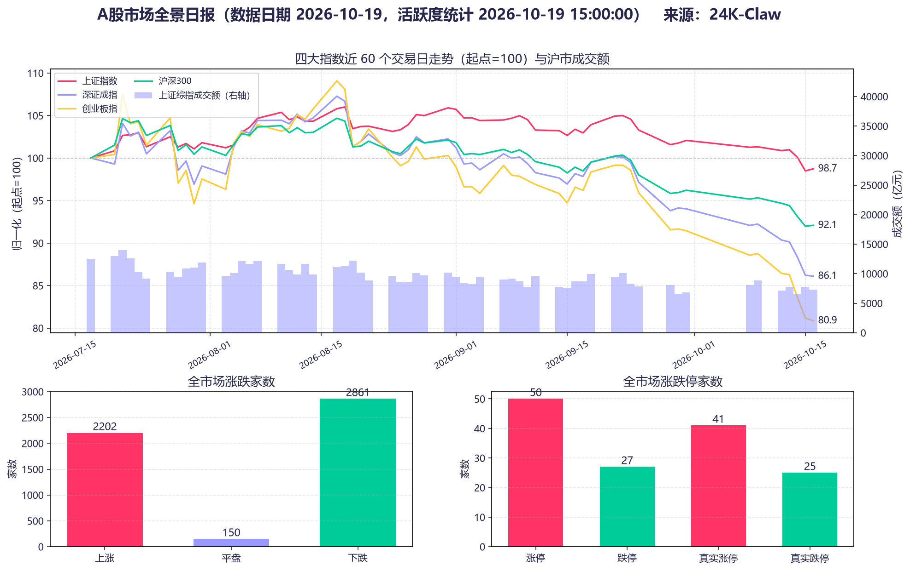
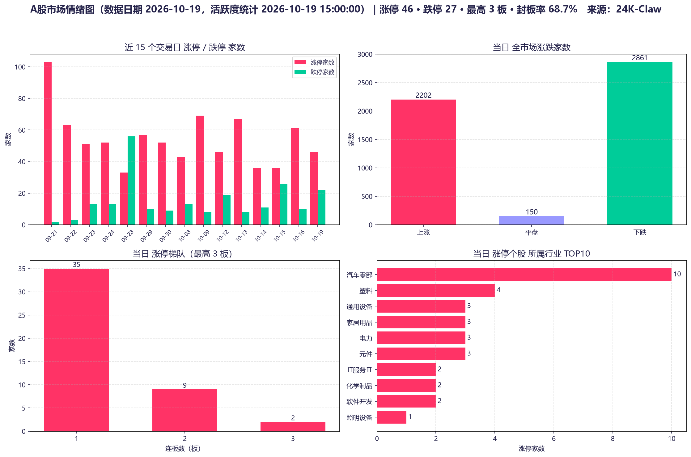
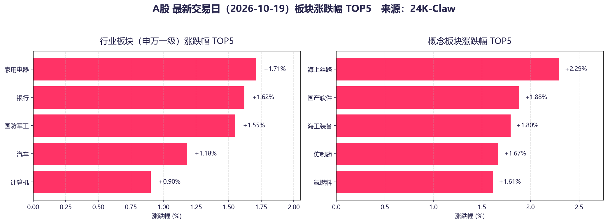
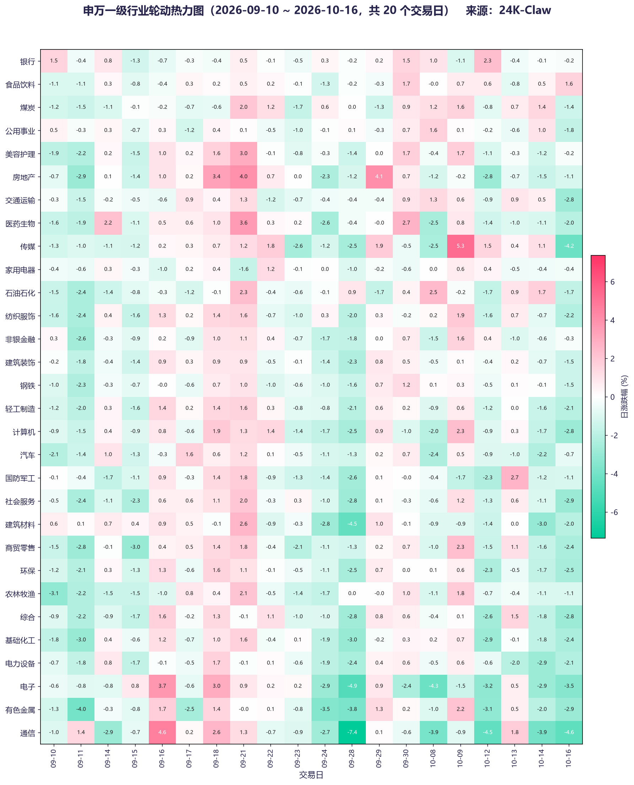
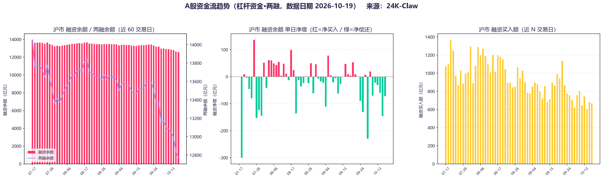
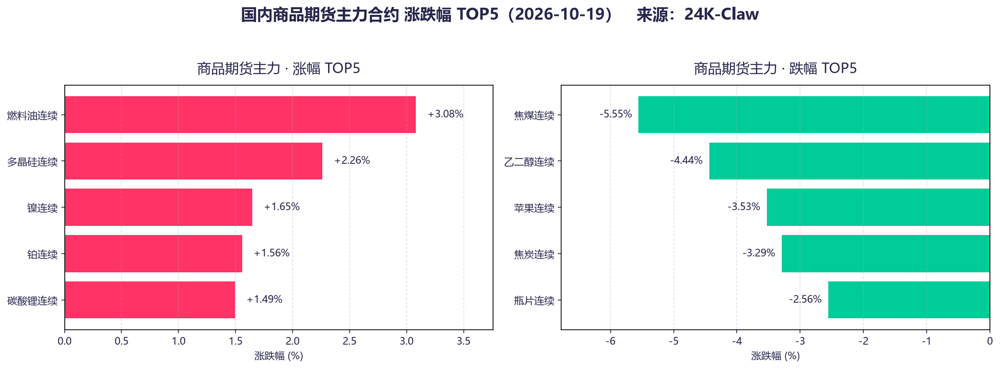
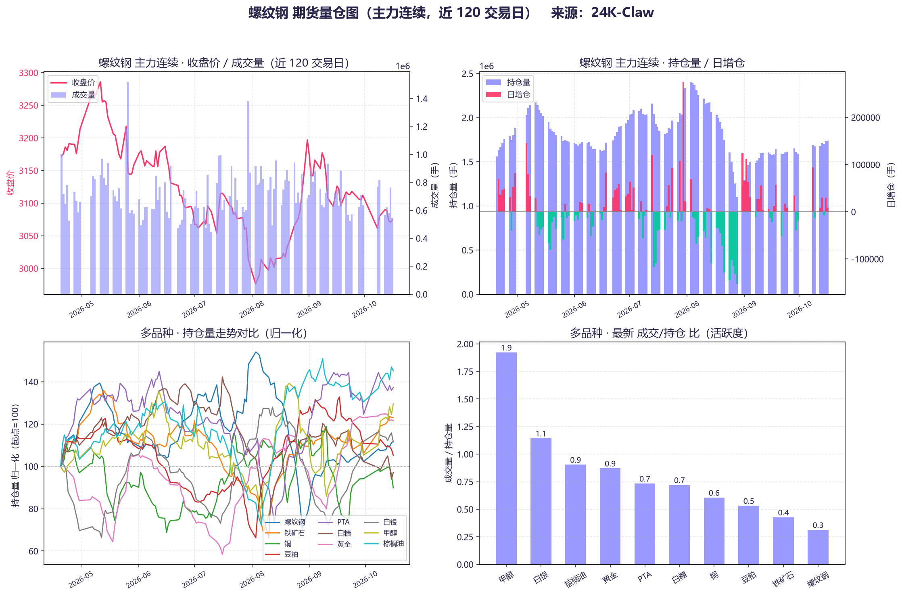
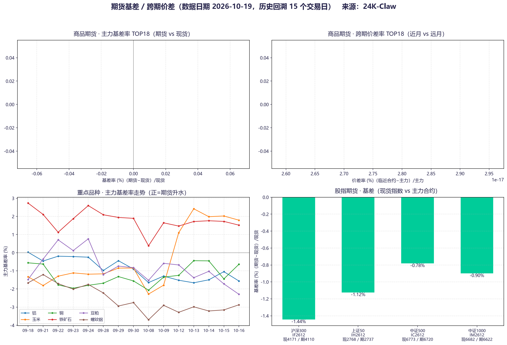

# A 股收盘分析 · 2026-10-19（周一）

来源：24K-Claw ｜ 数据脚本：`strategies/*` ｜ 图表：已嵌入下文（另归档于 `reports/` 与 `strategies/output/`）

---

## 核心摘要

**缩量分化修复日。** 指数沪强深弱（上证 +0.24% vs 创业板指 -0.39%），全市场下跌家数仍多于上涨（2861 vs 2202）；沪市成交 **7325 亿元**，较近 60 日均值（9629 亿）缩量约 **24%**。情绪指标边际修复但梯队偏弱（最高 3 板、封板率 68.7%）；杠杆资金（两融）连续净偿还尚未回流；商品黑色煤系领跌、股指期货维持深度贴水。缩量反弹的持续性存疑，反弹质量待量能确认。

---

## 一、指数表现

| 指数    | 收盘               | 当日涨跌             |
| ----- | ---------------- | ---------------- |
| 上证指数  | 3716.28          | **+0.24%**       |
| 沪深300 | 4170.61          | +0.11%           |
| 深证成指  | 11802.46         | -0.12%           |
| 创业板指  | 2772.38          | **-0.39%**       |
| 恒生指数  | 24186.83         | +0.52%           |
| 标普500 | 7659.44（10-16 收） | -1.09%（今日美盘尚在交易） |

- 近 60 交易日归一（7 月中旬=100）终点：上证 98.7、沪深300 92.1、深证 86.1、创业板 80.9 —— **中期结构性下行未改，双创持续跑输**。
- 上周（10-12~10-16）三大市场累计：沪深300 **-3.40%**、恒生 **-0.10%**、标普500 **-1.95%**；今日 A/港均有修复，属于上周大跌后的超跌反弹。

*图1：A 股市场全景日报 —— 四大指数归一化走势、沪市成交额缩量至 7325 亿、涨跌与涨跌停家数（数据日期 2026-10-19）*

## 二、市场情绪

| 指标           | 数值                                |
| ------------ | --------------------------------- |
| 涨 / 平 / 跌（家） | 2202 / 150 / **2861**             |
| 涨停（全市场宽口径）   | 50（真实涨停 41）                       |
| 跌停           | 27（真实跌停 25），停牌 11                 |
| 涨停梯队         | 首板 35 / 2 板 9 / 3 板 2（**最高 3 板**） |
| 封板率          | **68.7%**（情绪口径涨停 46、炸板 21）        |

- 对比上周五（10-16 涨停 61 家），今日涨停家数降至 46/50 家，**情绪降温但未失速**；跌停 27 家仍偏高。
- 涨停个股行业分布 TOP：**汽车零部件 10 家**、塑料 4、通用设备/家居用品/电力/元件 各 3、IT 服务/化学制品/软件开发 各 2 —— 涨停主线偏**汽车产业链 + 消费制造**，而非前期 TMT。

*图2：涨停/跌停 15 日趋势、当日涨跌家数、涨停梯队（最高 3 板）与涨停个股行业 TOP10（数据日期 2026-10-19）*

## 三、行业与板块

**行业（申万一级）涨幅 TOP5**：家用电器 +1.71%、银行 +1.62%、国防军工 +1.55%、汽车 +1.18%、计算机 +0.90%

**概念涨幅 TOP5**：海上丝路 +2.29%、国产软件 +1.88%、海工装备 +1.80%、仿制药 +1.67%、氢燃料 +1.61%

**轮动热力图（09-10 ~ 10-16，20 交易日）观察**：

- 区间累计跌幅居前：**通信（约 -22.6%）、有色金属（约 -18.5%）** 等科技/周期成长链，热力图上多次单日 -3%~-7% 深绿；电力设备、计算机亦大幅跑输。
- 区间相对强势：地产、医药生物、美容护理、银行等呈阶段性红色脉冲。
- 今日"国产软件 +1.88%/计算机 +0.90%"属于**超跌科技的反抽**，尚不足以确认主线回归。

*图3：申万一级行业与新浪概念板块涨跌幅 TOP5（数据日期 2026-10-19）*

*图4：申万一级行业轮动热力图（09-10 ~ 10-16，20 个交易日；数据滞后一天，当日值未含）*

## 四、成交与杠杆资金

- **成交**：沪市 7325 亿（60 日均 9629 亿），缩量约 1/4；量能未确认反弹。
- **两融**（上交所官方数据核验）：
  - 沪市融资余额 12,892 亿（10-12）→ 12,655 亿（10-15），**连续 3 日净偿还 -31 / -61 / -146 亿元**，累计约 -237 亿；
  - 融资买入额约 600-745 亿/日，显著低于 8-9 月千亿元级水平，**杠杆活跃度持续萎缩**；
  - 东财口径（脚本）：最新（10-16）融资余额 12,582 亿、净偿还约 -72 亿，与交易所节奏一致。
- 解读：指数反弹但**杠杆资金仍在离场**，本轮修复更可能是空头回补/超跌反抽性质。

*图5：沪市融资余额与两融余额近 60 交易日走势、融资单日净增（近期连续净偿还）与融资买入额萎缩*

## 五、期货与衍生品

**商品主力合约（10-19）**

| 涨幅 TOP | %     | 跌幅 TOP | %         |
| ------ | ----- | ------ | --------- |
| 燃料油    | +3.08 | **焦煤** | **-5.55** |
| 多晶硅    | +2.26 | 乙二醇    | -4.44     |
| 镍      | +1.65 | 苹果     | -3.53     |
| 铂      | +1.56 | 焦炭     | -3.29     |
| 碳酸锂    | +1.49 | 瓶片     | -2.56     |

- 黑色煤系（焦煤/焦炭）领跌，与地产/基建需求弱势一致；油系（燃料油）因海外原油偏强。
- **螺纹钢量仓**：主力收 **3074 元/吨**，持仓 174 万手（高位），日增仓 +8449 手；成交/持仓比 0.3，为 10 大品种中最低，**商品整体交易热情偏冷**。
- **股指期货基差（现货 vs 主力 2612）**：IF -1.44%、IH -1.12%、IC -0.78%、IM -0.90% —— 全线贴水且远月深度贴水，**对冲力量仍占主导；其中 IF 贴水最深**。

*图6：商品期货主力合约涨跌幅 TOP5 —— 黑色煤系（焦煤/焦炭）领跌*

*图7：螺纹钢主力量仓与多品种持仓/活跃度对比 —— 螺纹成交/持仓比 0.3 为最低*

*图8：重点品种主力基差率走势、股指期货全线贴水（商品现货基差面板今日数据缺失留空）*

## 六、数据缺失与异常（如实标注）

| 项目                | 状态                                        |
| ----------------- | ----------------------------------------- |
| 行业估值分位（申万 PE/PB）  | **缺失**：申万接口连续两次异常（JSON 解析错/超时），待重试        |
| 商品现货基差（生意社/新浪现货源） | **今日空**：现货价格取数返回为空，基差率 TOP 面板留空（历史走势面板正常） |
| 两融正式数据            | 交易所滞后：官方最新至 10-15；10-16 采用东财口径            |
| 轮动热力图             | 行业日度数据滞后一天（窗口截至 10-16）                    |

## 七、解读与提示

1. **反弹成色不足**：缩量（-24%）+ 跌停 27 家 + 融资端持续净偿还，三大要素制约反弹高度；短期重点观察量能能否重回 9000 亿上方。
2. **风格切换试探**：涨停偏向汽车零部件/家电/银行/军工（低位+防御+事件驱动），超跌 TMT 仅反抽；两融未回流前不宜将科技反弹升级为主线，仍以**低位轮动 + 拥挤度管理**为主。
3. **外部背景**：标普上周五 -1.09%、今日美盘仍在交易日，隔夜变量对明日开盘影响较大；恒指 +0.52% 与商品镍/锂反弹提供边际支撑。
4. **商品信号**：焦煤 -5.55% 再创新低方向，黑色链弱势与股指 IF 深贴水共振，反映远月经济预期仍偏谨慎。

> 免责声明：本项目所有输出内容仅供研究与学习参考，不构成任何投资建议。投资有风险，据此操作风险自担，请结合自身风险承受能力独立决策。
